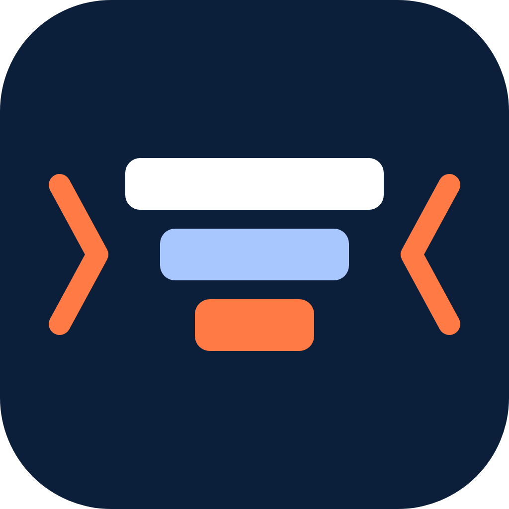
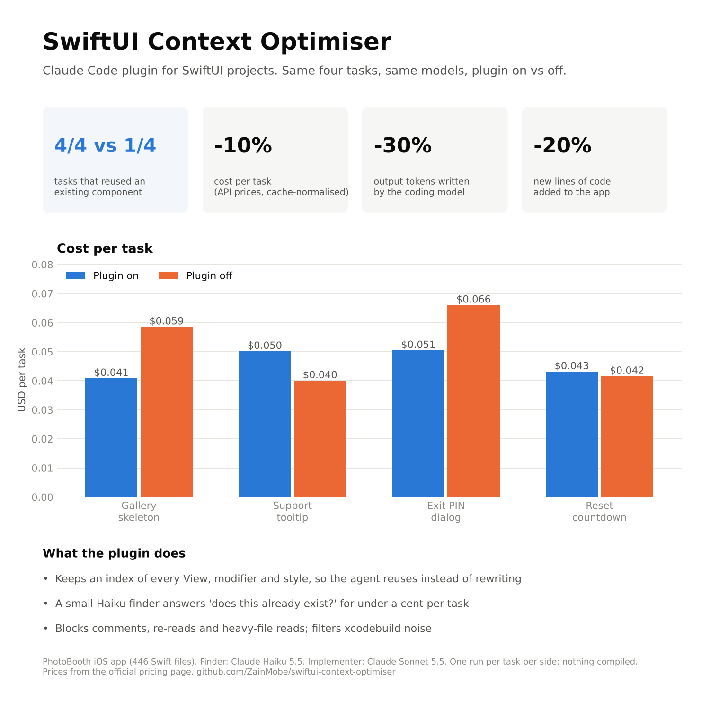
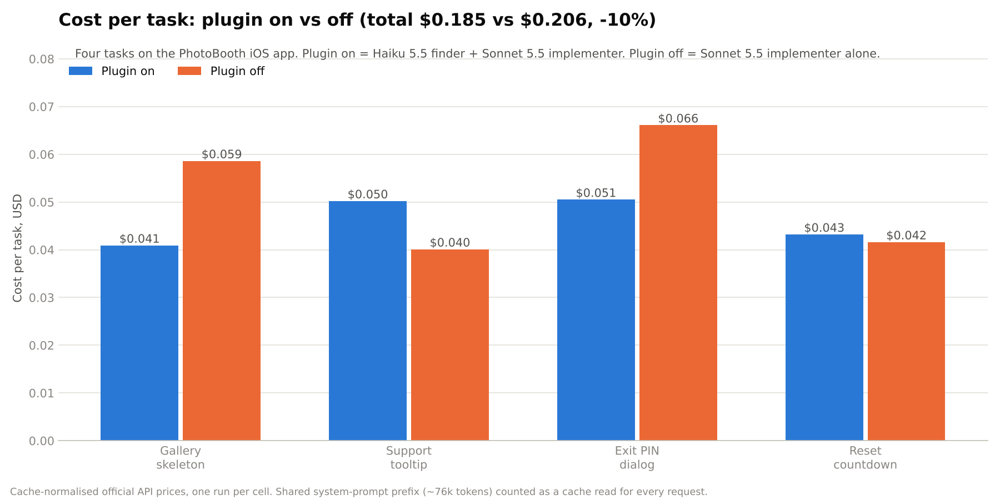
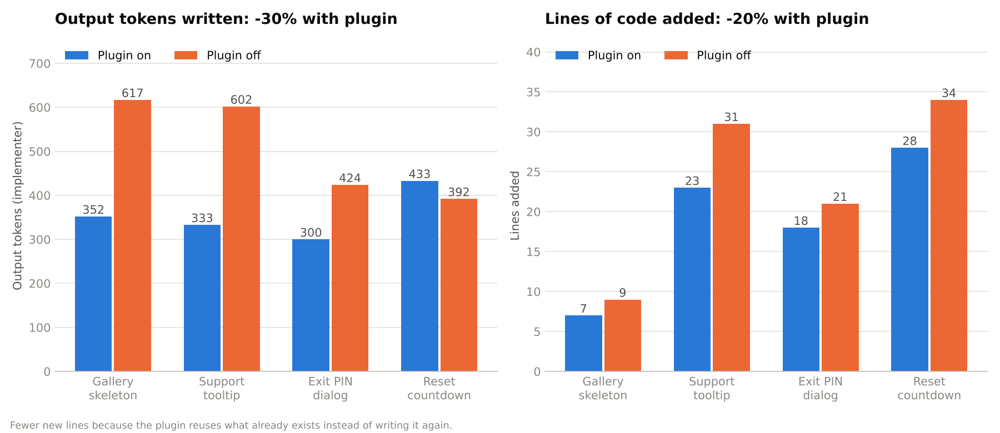
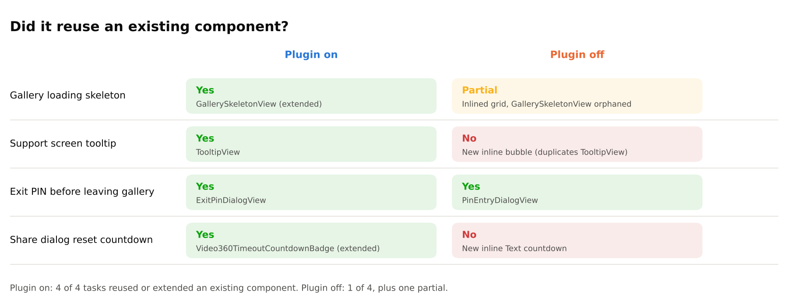

<p align="center"></p>

# SwiftUI Context Optimiser

A Claude Code plugin that lowers token usage on SwiftUI projects by enforcing six working rules and trimming what enters the context window.

## What it enforces

1. Reuse first: existing Views, modifiers, styles and models are found before new ones are written.
2. No comments until asked (overrides the SwiftUI Pro skill's comment guidance).
3. Ask the developer when something is unclear instead of guessing.
4. Keep code consistent with the project's recorded conventions.
5. Periodic memory digests that keep CLAUDE.md and auto-memory lean.
6. Context thrift: Grep before Read, subagents for exploration, filtered build output.

## Components

| Component | What it does | Cost |
|---|---|---|
| SessionStart hook | Injects the rule block (about 300 tokens), rebuilds the component index, nudges for a digest when notes exceed limits. Fires on startup, resume, clear and after compaction. Silent on non-Swift projects. | Once per session |
| PreToolUse Write hook | Denies a Write that declares a UI type whose name already exists elsewhere; injects near-match candidates otherwise. | Only on new .swift files |
| PreToolUse Read guard | Denies reads of `.pbxproj`, `Package.resolved`, `.xcstrings`, `.xcassets` JSON, anything under `DerivedData`, `.build`, `Pods`; denies full reads of files over 24 KB; denies a second full read of a file unchanged since it was read earlier in the session. Ranged reads (`offset`/`limit`) always pass, so content can be recovered after compaction. | Zero |
| PreToolUse comment blocker | Denies Swift Write/Edit calls that add `//`, `///`, `/*` or `// MARK:` lines. SwiftLint, swift-format and `swift-tools-version` directives are exempt; comments already present in the text being edited are not counted. | Zero |
| PreToolUse Bash hook | Rewrites `xcodebuild`, `swift build`, `swift test` to pipe through a filter that keeps errors, warnings, test failures and the verdict. Append `\| cat` to see everything. | Zero |
| PostToolUse hook (async) | Rebuilds `.claude/swiftui-components.md` after any Swift file write. | Zero |
| `component-finder` agent | Haiku, read-only, isolated context. Returns REUSE / EXTEND / CREATE NEW with paths. | Subagent tokens only |
| `/swiftui-context-optimiser:init-project` | Scaffolds a lean CLAUDE.md with compact instructions, a path-scoped Swift rule, the index, and offers the Haiku Explore override. | Manual |
| `/swiftui-context-optimiser:learn-conventions` | Writes `.claude/conventions.md` (40 lines max) from the existing code. | Manual |
| `/swiftui-context-optimiser:digest` | Consolidates CLAUDE.md and auto-memory; shows what it will drop before writing. | Manual, nudged |
| `/swiftui-context-optimiser:usage-report` | Parses the latest transcript and names the biggest context consumers with specific fixes. | Manual |

All skills are `disable-model-invocation: true`, so their descriptions do not occupy context until you invoke them.

## Install

From GitHub (any machine):

```bash
claude plugin marketplace add ZainMobe/swiftui-context-optimiser
claude plugin install swiftui-context-optimiser@wapp-local
```

Update later with `claude plugin marketplace update wapp-local` then `claude plugin update swiftui-context-optimiser`.

Requires `python3` on PATH (ships with Xcode command line tools).

### Try it for one session without installing

```bash
git clone https://github.com/ZainMobe/swiftui-context-optimiser.git
claude --plugin-dir ./swiftui-context-optimiser
```

### Development from a local clone

```bash
git clone https://github.com/ZainMobe/swiftui-context-optimiser.git
claude plugin marketplace add ./swiftui-context-optimiser
claude plugin install swiftui-context-optimiser@wapp-local
```

A GitHub marketplace and a local one cannot be registered at the same time because they share the marketplace name. Remove one with `claude plugin marketplace remove wapp-local` before adding the other.

Validate after edits:

```bash
claude plugin validate ./swiftui-context-optimiser
```

## Security and trust

This plugin runs hooks and scripts on your machine, so read them before installing. Everything that executes lives in `hooks/` and `scripts/`, and the hooks are registered in `hooks/hooks.json`.

- The Python scripts contain no network calls and do not spawn processes. Check with `grep -rn "urllib\|socket\|subprocess" hooks scripts`.
- Hooks read project files and write only two things: the component index at `.claude/swiftui-components.md` inside your project, and a small per-session read-tracking file in the session scratch or temp directory.
- The `digest`, `init-project` and `learn-conventions` commands are skills that Claude runs on request. They edit `CLAUDE.md`, `.claude/` files and auto-memory, and they show what they will change first.
- The Bash hook rewrites build commands (`xcodebuild`, `swift build`, `swift test`) to filter their output. It does not run anything else.

To report a vulnerability, see [SECURITY.md](SECURITY.md). Please do not open a public issue for it.

## Contributing

Pull requests are welcome. `main` is protected: all changes go through a pull request that the maintainer reviews, and changes to hooks, scripts or the plugin manifest get extra scrutiny. Fork the repo, create a branch, run the evals below, and open a pull request describing the change.

## First use in a project

1. `cd` into the Swift project and start Claude Code.
2. Run `/swiftui-context-optimiser:init-project`.
3. For existing codebases, run `/swiftui-context-optimiser:learn-conventions`.
4. Work normally. Run `/swiftui-context-optimiser:digest` when the session start nudge appears.

## Benchmark

Four real tasks on a production SwiftUI app (446 Swift files, 396 indexed components), each run once with the plugin on and once with it off, on throwaway copies of the source. Same models both sides: Claude Sonnet 5.5 writes the code; with the plugin on, a Claude Haiku 5.5 finder agent answers "does this already exist?" first.

| | Plugin on | Plugin off | Change |
|---|---|---|---|
| Tasks that reused or extended an existing component | 4 of 4 | 1 of 4 (plus 1 partial) | |
| Cost per 4 tasks, cache-normalised official API prices | $0.185 | $0.206 | -10% |
| Output tokens written by the coding model | 1,418 | 2,035 | -30% |
| API requests to Sonnet | 18 | 21 | -14% |
| New lines of code added to the app | 76 | 95 | -20% |
| Finder cost (Haiku) | under $0.01 per task | none | |









Without the plugin, the agent rewrote a tooltip the app already had, built a third countdown label, and bypassed an existing skeleton view, leaving it unused. With the plugin, every task reused or extended an existing component.

**These numbers are from the first prompt of a fresh session.** That is the plugin's worst case: the index and rule block are paid for up front and the guards have had nothing to block yet. Over a longer session the savings compound. The re-read guard stops the same file entering the context twice, the heavy-file guard keeps project files and asset catalogs out, the build filter cuts xcodebuild output to the lines that matter, and the digest keeps CLAUDE.md and memory lean. In long sessions on large projects the plugin can save up to 60% of tokens compared with running without it.

Full tables, what each run produced, raw data (JSON and CSV) and caveats (one run per cell, nothing compiled) are in [docs/benchmark](docs/benchmark/README.md).

## Measuring the effect

`evals/` holds three cases (reuse an existing modifier, no comments in a new view, ask when the request is unclear), each with a scaffolded mini project. Run from the plugin root:

```bash
claude plugin eval . --scaffold --allow-tools Write Edit --trust-plugin
```

Each case runs with and without the plugin and the report shows the delta, the token cost per run, and which graders passed. Use `--ablation none` while iterating on graders to halve the cost. `evals/results/` is gitignored.

## Limits and known tradeoffs

- The comment blocker cannot know when you have asked for comments; when you do, say "comments are requested for this file" and Claude will state that and retry. If this becomes a nuisance, remove the `comment_blocker.py` entry from `hooks/hooks.json` and rely on the rule alone.
- The re-read guard keys on session id and file mtime. Formatters that rewrite files on save change the mtime and legitimately allow a re-read.
- Plugins cannot ship always-on CLAUDE.md or rules files. The SessionStart hook is the only always-on channel, which is why the rule block is short and why `init-project` also writes a CLAUDE.md (so rules survive if the plugin is disabled).
- A plugin agent named `Explore` registers as `swiftui-context-optimiser:Explore` and does not replace the built-in. The Haiku override must live in `~/.claude/agents/Explore.md`; `init-project` installs it on request. It affects all projects.
- The build filter only rewrites single-line commands and skips commands already piped through `xcbeautify`, `xcpretty`, `grep`, `tail`, `head` or `tee`. It does not touch Xcode MCP tools.
- Hooks run only in Claude Code (CLI, desktop, web). In claude.ai chat only the skills load.
- The duplicate-type denial is name based. Two types with the same name in different modules are legal Swift but still flagged; rename or confirm reuse is impossible.
- Thresholds (CLAUDE.md 80 lines, MEMORY.md 120 lines, auto-memory 25 KB) are constants at the top of `hooks/scripts/session_start.py`.

## Files written into a project

- `.claude/swiftui-components.md` (generated; consider gitignoring)
- `.claude/conventions.md` (from learn-conventions)
- `.claude/rules/swift.md` and `CLAUDE.md` (from init-project)

## License

MIT. See [LICENSE](LICENSE).
